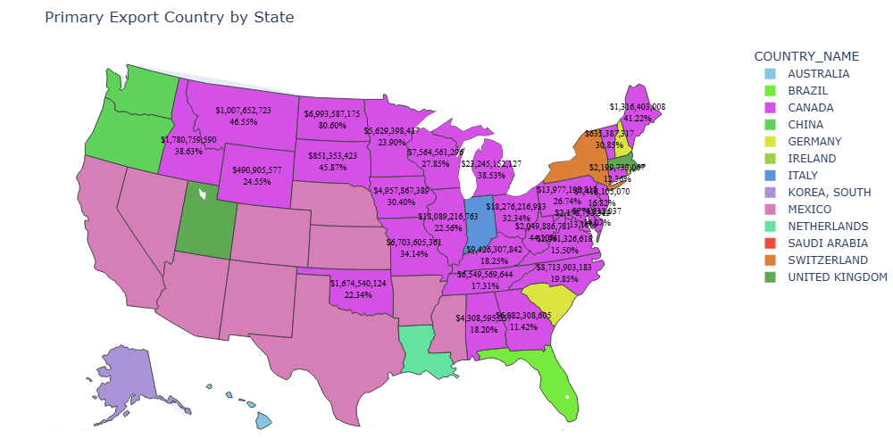
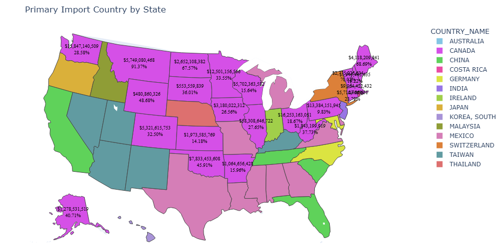

# Primary Import and Export Countries by State

## Background

Following the announcement by the new administration to raise tariffs on Canada, Mexico, and China (and the not entirely unexpected retaliatory measures from those targeted countries), it would be interesting to know which countries are the primary sources and destinations for imports and exports.

This data can be viewed using the US government’s International Trade Administration the page located at [https://www.trade.gov/data-visualization/tradestats-express-state-trade-product](https://www.trade.gov/data-visualization/tradestats-express-state-trade-product) although that page is simply a container for n iframe whose contents are actually located at [https://tsereports.trade.gov/views/StateAnnualDashboardLive_16421978287720/StateTradebyPartners?%3Atoolbar=yes%2Ctop&%3AshowVizHome=no&%3Aembed=true](https://tsereports.trade.gov/views/StateAnnualDashboardLive_16421978287720/StateTradebyPartners?%3Atoolbar=yes%2Ctop&%3AshowVizHome=no&%3Aembed=true) and are themselves created using Tableau.

However, scraping this page is problematic, not least becuase of all the DOM selector work that needs to be done, as well as interacting with the page once it loads (to click on combo box items, etc.), but also because the embedded link contained within the iframe changes constantly (by the time you check again, this link may no longer be valid, even though as of this writing, it is working).

Instead, we can go to the source of this data which is actually hosted on the US government's census.gov site and source the required data using the available API.

After acquiring the data, we also want to display it graphically using a map of the USA to show each state’s dependence on their primary export and import partners. For this, we will employ Choropleth maps.

You can view the resulting notebook file [get_top_export_countries_by_state.ipynb](get_top_export_countries_by_state.ipynb)

## Output

The resulting images that the notebook generates are the following

## Comments

### Original Tariff Anouncment around Feb. 2025

Following the reaction of investors and the destruction of value in the stock markets upon the administration announcing that the tariffs would be imposed, the administration quickly backtracked allegedly for a 30-day reprieve (which, given our understanding of the new president, will likely never be mentioned again) for both Canada and Mexico. Now seeing who the largest trading partners are (~80% of states export primarily to Canada or Mexico, and ~67% of states import primarily from Canada or Mexico), had the tariffs remained in place, the pain on exporters and consumers would have been significant.

### New Tariff Anouncement on Canada in Aug. 2026

Following the announcement that Canada will suffer tariffs of 50% on exports to the USA,
and the reciprocal tariffs enacted by Canada on US exports, based on the stats collected
from the trade.gov website show that the following states all have the percent of goods
and exports to Canada in proportion to the exports to the entire world exceeding
the national average of 25.80%. The reciprocal tariffs are going to bite hard on these states.

<html>
<body>
<table border="1" class="dataframe">
  <thead>
    <tr style="text-align: left;">
      <th>STATE</th>
      <th>EXPORT %</th>
    </tr>
  </thead>
  <tbody>
    <tr>
      <th style="text-align: left;">North Dakota</th>
      <td style="text-align: right;">80.60%</td>
    </tr>
    <tr>
      <th style="text-align: left;">Montana</th>
      <td style="text-align: right;">46.55%</td>
    </tr>
    <tr>
      <th style="text-align: left;">South Dakota</th>
      <td style="text-align: right;">45.87%</td>
    </tr>
    <tr>
      <th style="text-align: left;">West Virginia</th>
      <td style="text-align: right;">44.10%</td>
    </tr>
    <tr>
      <th style="text-align: left;">Maine</th>
      <td style="text-align: right;">41.22%</td>
    </tr>
    <tr>
      <th style="text-align: left;">Idaho</th>
      <td style="text-align: right;">38.63%</td>
    </tr>
    <tr>
      <th style="text-align: left;">Michigan</th>
      <td style="text-align: right;">38.53%</td>
    </tr>
    <tr>
      <th style="text-align: left;">Missouri</th>
      <td style="text-align: right;">34.14%</td>
    </tr>
    <tr>
      <th style="text-align: left;">Ohio</th>
      <td style="text-align: right;">32.34%</td>
    </tr>
    <tr>
      <th style="text-align: left;">Vermont</th>
      <td style="text-align: right;">30.85%</td>
    </tr>
    <tr>
      <th style="text-align: left;">Iowa</th>
      <td style="text-align: right;">30.40%</td>
    </tr>
    <tr>
      <th style="text-align: left;">Wisconsin</th>
      <td style="text-align: right;">27.85%</td>
    </tr>
    <tr>
      <th style="text-align: left;">Pennsylvania</th>
      <td style="text-align: right;">26.74%</td>
    </tr>
  </tbody>
</table>
</body>
</html>>

Similarly, the states with the percentage of their imports from Canada in proportion to goods and services
imported from the rest of the world exceeding the average across the USA of 28.39% are:

<html>
<body>
<table border="1" class="dataframe">
  <thead>
    <tr style="text-align: right;">
      <th>STATE</th>
      <th>IMPORT %</th>
    </tr>
  </thead>
  <tbody style="vertical-align: middle;">
    <tr>
      <th style="text-align: left;">Montana</th>
      <td style="text-align: right;">91.37%</td>
    </tr>
    <tr>
      <th style="text-align: left;">Vermont</th>
      <td style="text-align: right;">70.02%</td>
    </tr>
    <tr>
      <th style="text-align: left;">Maine</th>
      <td style="text-align: right;">68.69%</td>
    </tr>
    <tr>
      <th style="text-align: left;">North Dakota</th>
      <td style="text-align: right;">67.57%</td>
    </tr>
    <tr>
      <th style="text-align: left;">Wyoming</th>
      <td style="text-align: right;">48.68%</td>
    </tr>
    <tr>
      <th style="text-align: left;">Michigan</th>
      <td style="text-align: right;">47.24%</td>
    </tr>
    <tr>
      <th style="text-align: left;">Oklahoma</th>
      <td style="text-align: right;">45.91%</td>
    </tr>
    <tr>
      <th style="text-align: left;">West Virginia</th>
      <td style="text-align: right;">37.73%</td>
    </tr>
    <tr>
      <th style="text-align: left;">South Dakota</th>
      <td style="text-align: right;">36.01%</td>
    </tr>
    <tr>
      <th style="text-align: left;">Minnesota</th>
      <td style="text-align: right;">33.55%</td>
    </tr>
    <tr>
      <th style="text-align: left;">Idaho</th>
      <td style="text-align: right;">32.48%</td>
    </tr>
  </tbody>
</table>
</body>
</html>>